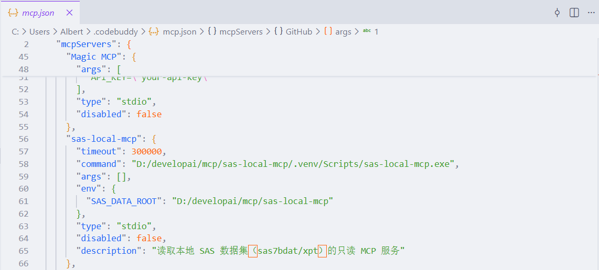
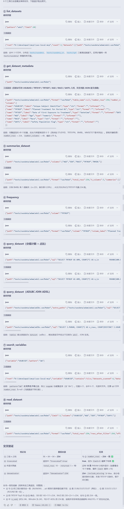

# 别再导出 Excel 给 AI 了：我把本地 .sas7bdat 直接接进了大模型

> 副标题：不用 Viya、不用联网、不用 SAS 授权，数据一个字节都不出本机
> 项目：<https://github.com/albert-huan/sas-local-mcp>（MIT，v0.1.0）

本文所有演示，均用仓库自带的公开测试数据跑出（SDTM/ADaM 各 17 个数据集，源自 CDISC pilot），返回结果是真实输出，未做任何修饰。

---

## 一、先说痛点

做过临床编程的同学，大概都经历过这几件事。

**想让 AI 帮你勘察一张表，第一步就卡住了。** 你手上是 `adsl.sas7bdat`。大模型不认这种格式——它不是 CSV，不能复制粘贴进去，也不能直接 `open()`。你得先手工导出 Excel、挑几列、贴进对话框，才能保证不超 token。

**用 AI 就得上传数据？** 临床试验数据有合规红线。把受试者级数据发到公网模型，这基本是禁区。

**想把 LLM 接进本地工作流，生态几乎是空的。** SAS 那边有 Viya，但要授权、要服务器、要联网；Python/R 工具很多，可你的主数据在 sas7bdat 里，格式本身就是一道墙。

于是有了 **sas-local-mcp**：一个跑在你自己电脑上的 MCP 服务器，让大模型**直接**查询本地 SAS 数据集。

## 二、它是什么

基于 [FastMCP](https://github.com/jlowin/fastmcp) 实现，底层用 [pyreadstat](https://github.com/Roche/pyreadstat) 读 `.sas7bdat` / `.xpt`，用 [DuckDB](https://duckdb.org) 跑 SQL：

```
┌──────────────────────────────────────────────┐
│  MCP Client (CodeBuddy / Claude / Cursor)    │
└──────────────┬───────────────────────────────┘
               │  stdio / JSON-RPC
┌──────────────▼───────────────────────────────┐
│  FastMCP 4.x                                 │
├──────────────────────────────────────────────┤
│  tools.py   8 个工具，参数校验 + 错误收敛    │
│  dataset.py 读取 / 元数据 / SQL / 缓存       │
│  config.py  环境变量、沙箱边界、限流阈值     │
├──────────────┬──────────────┬────────────────┤
│  pyreadstat  │   pandas     │    duckdb      │
└──────────────┴──────────────┴────────────────┘
               │
      本地文件系统（只读，受 SAS_DATA_ROOT 约束）
```

三个关键词：**本地**、**只读**、**零 SAS 依赖**。它通过 stdio 协议接入任意兼容 MCP 的客户端。

## 三、三步跑起来

```bash
git clone https://github.com/albert-huan/sas-local-mcp.git
cd sas-local-mcp

uv sync              # 依赖只有四个
uv run sas-local-mcp
```

依赖：`fastmcp` 4.x、`pandas` ≥ 2.0、`pyreadstat` ≥ 1.2.8、`duckdb` ≥ 1.1.0，Python ≥ 3.11。

客户端配置两段就够：

```json
{
  "mcpServers": {
    "sas-local-mcp": {
      "type": "stdio",
      "command": "/abs/path/to/sas-local-mcp",
      "args": [],
      "env": { "SAS_DATA_ROOT": "/abs/path/to/your/data/root" }
    }
  }
}
```

> 
> 图 1：客户端里的 MCP 配置，`command` 指向可执行入口，`SAS_DATA_ROOT` 是数据根目录兼安全边界

## 四、实操演示：一次真实的勘察

以下用仓库自带的测试数据（`tests/sasdata`，SDTM/ADaM 共 34 个数据集）。数据根指向仓库的 `tests/sasdata`，所以路径写法是 `adam/adsl.sas7bdat` 这种相对形式。

### ① 找数据集

```txt
>>> list_datasets(pattern="adsl", limit=10)
```

```json
{
  "root": "D:\\developai\\mcp\\sas-local-mcp\\tests\\sasdata",
  "count": 1,
  "datasets": [{
    "path": "adam/adsl.sas7bdat",
    "name": "adsl.sas7bdat",
    "format": "sas7bdat",
    "size_bytes": 196608,
    "modified": "2026-10-20T14:39:23"
  }]
}
```

### ② 看表结构

```txt
>>> get_dataset_metadata(path="adam/adsl.sas7bdat")
```

```json
{
  "path": "adam/adsl.sas7bdat",
  "format": "sas7bdat",
  "number_rows": 254,
  "number_columns": 49,
  "file_encoding": "UTF-8",
  "columns(节选)": [
    { "name": "USUBJID", "label": "Unique Subject Identifier",  "type": "str"      },
    { "name": "TRT01P",  "label": "Planned Treatment ... 01",    "type": "str"      },
    { "name": "TRTSDT",  "label": "Date of First Exposure ...",  "type": "datetime", "informat": "DATE9" },
    { "name": "AGE",     "label": "Age",                         "type": "numeric"  },
    { "name": "RACE",    "label": "Race",                        "type": "str"      },
    { "name": "SAFFL",   "label": "Safety Population Flag",      "type": "str"      }
  ]
}
```

注意 `TRTSDT` 被认成 `datetime` 而不是数值——SAS 日期列常只带 format 不带 informat，只按 informat 判断会漏判（见后文"坑 2"）。**这一步完全不加载数据行**，几百毫秒返回。

### ③ 逐变量统计（本文推荐的首选入口）

```txt
>>> summarize_dataset(path="adam/adsl.sas7bdat",
                      columns=["AGE", "SEX", "RACE", "TRT01P", "BMIBL"])
```

```json
{ "name": "AGE", "type": "numeric", "n": 254, "n_missing": 0, "pct_missing": 0.0,
  "n_distinct": 36,
  "stats": { "mean": 75.09, "std": 8.25, "min": 51.0,
             "p25": 70.0, "median": 77.0, "p75": 81.0, "max": 89.0 } }

{ "name": "SEX", "type": "str", "n": 254, "n_distinct": 2,
  "stats": { "max_length": 1,
             "top_values": [ {"value": "F", "n": 143, "pct": 56.3},
                             {"value": "M", "n": 111, "pct": 43.7} ] } }

{ "name": "BMIBL", "type": "numeric", "n": 253, "n_missing": 1, "pct_missing": 0.39,
  "n_distinct": 122,
  "stats": { "mean": 24.67, "std": 4.09, "min": 13.7,
             "p25": 21.9, "median": 24.2, "p75": 27.3, "max": 40.1 } }
```

一次调用，模型就知道了：样本 254 人、平均年龄 75 岁、女性占 56.3%、基线 BMI 有 1 个缺失。**它没读过一行原始数据，也没手写一句 SQL。**

### ④ 频数表

```txt
>>> frequency(path="adam/adsl.sas7bdat", column="TRT01P")
```

```json
{ "column": "TRT01P", "total_rows": 254, "n_missing": 0, "n_distinct": 3,
  "denominator": 254, "include_missing": false,
  "levels": [
    { "value": "Placebo",             "n": 86, "pct": 33.86 },
    { "value": "Xanomeline High Dose","n": 84, "pct": 33.07 },
    { "value": "Xanomeline Low Dose", "n": 84, "pct": 33.07 }
  ]}
```

返回体里的 `denominator` 是刻意设计的：`include_missing=True` 时它是总行数，否则是非缺失行数。QC 时这两个分母算出的百分比完全不是一回事，必须显式回传。

### ⑤ 写 SQL 聚合

```txt
>>> query_dataset(path="adam/adsl.sas7bdat", sql="""
      SELECT TRT01P AS ARM, COUNT(*) AS n,
             ROUND(100.0*COUNT(*)/(SELECT COUNT(*) FROM dataset),1) AS pct
      FROM dataset GROUP BY TRT01P ORDER BY TRT01P """)
```

```json
{ "tables": { "dataset": "adam/adsl.sas7bdat" },
  "total_rows": 3,
  "records": [
    { "ARM": "Placebo",              "n": 86, "pct": 33.9 },
    { "ARM": "Xanomeline High Dose", "n": 84, "pct": 33.1 },
    { "ARM": "Xanomeline Low Dose",  "n": 84, "pct": 33.1 }
  ]}
```

86 + 84 + 84 = 254，与元数据行数一致，交叉验证通过。

### ⑥ 跨数据集 JOIN

`extra_paths` 传入附加数据集，按文件名主干注册为额外表：

```txt
>>> query_dataset(
      path="adam/adlbc.sas7bdat",
      extra_paths=["adam/adsl.sas7bdat"],
      sql="""SELECT l.PARAM, COUNT(*) AS n_rows, COUNT(DISTINCT l.USUBJID) AS n_subj
             FROM dataset l INNER JOIN adsl d USING (USUBJID)
             WHERE l.ANL01FL='Y' GROUP BY l.PARAM ORDER BY l.PARAM""")
```

```json
{ "tables": { "dataset": "adam/adlbc.sas7bdat", "adsl": "adam/adsl.sas7bdat" },
  "total_rows": 18, "returned": 5, "truncated": true,
  "records": [
    { "PARAM": "Alanine Aminotransferase (U/L)", "n_rows": 318, "n_subj": 246 },
    { "PARAM": "Albumin (g/L)",                  "n_rows": 287, "n_subj": 246 },
    { "PARAM": "Alkaline Phosphatase (U/L)",     "n_rows": 321, "n_subj": 246 },
    { "PARAM": "Aspartate Aminotransferase (U/L)","n_rows": 314, "n_subj": 246 },
    { "PARAM": "Bilirubin (umol/L)",             "n_rows": 287, "n_subj": 245 }
  ]}
```

`truncated: true` 明确告知还有 13 个参数未见，模型知道要去翻页——这类"不完整的分布"如果静默返回，模型会得出错误结论。

### ⑦ 变量溯源

```txt
>>> search_variables(variable="USUBJID", pattern="dm")
```

```json
{ "datasets_scanned": 2, "datasets_matched": 2, "scan_truncated": false,
  "matches": [
    { "path": "sdtm/dm.sas7bdat",    "variable": "USUBJID", "label": "Unique Subject Identifier", "number_rows": 306  },
    { "path": "sdtm/suppdm.sas7bdat","variable": "USUBJID", "label": "Unique Subject Identifier", "number_rows": 1197 }
  ]}
```

只读元数据、不加载数据行，几十个数据集几百毫秒扫完。支持 `contains=True` 做子串匹配（`AGE` 命中 `AGE` / `AGEU` / `AGEGR1`）。

### ⑧ 行预览

```txt
>>> read_dataset(path="adam/adsl.sas7bdat", limit=3,
                 columns=["USUBJID","AGE","SEX","TRT01P","SAFFL"])
```

```json
{ "total_rows": 254, "rows_after_filter": 254, "truncated": true,
  "records": [
    { "USUBJID": "01-701-1015", "AGE": 63.0, "SEX": "F", "TRT01P": "Placebo",             "SAFFL": "Y" },
    { "USUBJID": "01-701-1023", "AGE": 64.0, "SEX": "M", "TRT01P": "Placebo",             "SAFFL": "Y" },
    { "USUBJID": "01-701-1028", "AGE": 71.0, "SEX": "M", "TRT01P": "Xanomeline High Dose","SAFFL": "Y" }
  ]}
```

> 
> 图 2：以上 8 个工具在客户端里被模型依次调用，每条都带参数与耗时

整轮勘察（8 次工具调用），模型没读过一行你没让它读的数据，也没把任何数据发到外部。

本机实测返回的原始片段——八个工具依次调用，路径、行数、分位数、频数分母都是真值

## 五、八个工具，一条完整勘察链

| 工具 | 解决什么 | 关键参数 |
| --- | --- | --- |
| `list_datasets` | 递归列出根目录下所有 `.sas7bdat` / `.xpt` / `.sas7bcat` | `pattern`、`limit` |
| `get_dataset_metadata` | 行数、列数、每列 label / type / format、文件标签 | `path` |
| `summarize_dataset` | **逐变量**概要：缺失率、唯一值数、分位数 / Top5 | `path`、`columns` |
| `frequency` | 单变量频数表，**默认自动套用 SAS 值标签** | `column`、`include_missing` |
| `read_dataset` | 分页读记录，支持列子集、`where` 过滤 | `limit`、`offset`、`where` |
| `get_value_labels` | 值标签映射（QC 解码 coded 值） | `path` |
| `query_dataset` | DuckDB SQL，单条 `SELECT`，支持 CTE 与多表 JOIN | `sql`、`extra_paths` |
| `search_variables` | 跨数据集搜变量 | `variable`、`contains` |

推荐顺序是**分层下钻**：

```
list_datasets / search_variables   ← 目录级，只读文件名/元数据
        ↓
get_dataset_metadata               ← 结构级，不加载数据行
        ↓
summarize_dataset                  ← 统计级，逐变量分布
        ↓
frequency                          ← 取值级，分类变量频数
        ↓
read_dataset / query_dataset       ← 行级，按需取细节
```

动机是 **token 经济**：先看目录再看结构再看分布，最后才取行，一次问答几百到几千 token；反过来一上来就读全表，6 万行 × 46 列的数据集直接把上下文撑爆。

## 六、技术深潜：实现中踩到的坑

技术选型很平淡，复杂度全在语义层和边界处理上。

**坑 1：XPORT 的行数是假的。** `pyreadstat` 对 `.xpt` 做 metadata-only 读取时 `meta.number_rows` 返回 `None`、DataFrame 为空。直接采信会把 6 万行的数据集报成 **0 行**。处理：`.xpt` 场景退回全量读一次拿真实行数，结果同样进缓存。

**坑 2：日期列判定要看 format，不能只看 informat。** SAS 日期变量常只带 format（如 `DATE9.`）。只按 informat 判断会把日期列当普通数值，统计结果给出 min/max 而非时间范围。

**坑 3：`where` 的求值顺序。** `read_dataset` 的 `where` 是在 `columns` 投影**之后**求值的，过滤条件只能引用 `columns` 里保留的变量。这是 pandas 的自然语义，但必须写进工具的 docstring——不然模型会反复犯同一个错。

**坑 4：两个限流阈值必须分开。** `MAX_ROWS`（行预览，默认 200）与 `MAX_AGG_ROWS`（聚合结果，默认 1000）不是一回事。`GROUP BY` 基数经常远超预览行数。若聚合也被 200 截断，模型读到**不完整的分布**并得出错误结论——不报错，但结果错，是最危险的一类 bug。

**坑 5：值标签必须默认解码。** coded 变量里存的是 `"1"/"2"`，不套 SAS 值标签，模型只看到"几个取值"。所以 `frequency` 的 `apply_labels` 默认 `True`；`summarize_dataset` 额外返回 `has_value_labels` 提示位，告诉模型"去调 `frequency`"。

**坑 6：分母语义要显式回传。** `frequency` 返回体带 `denominator`，`include_missing` 与否对应两种分母。QC 时这两者算出的百分比完全不是一回事。

**坑 7：编码与类型归一化。** 同一份数据在不同环境转出的编码不同，测试集里专门准备了 UTF-8 与 EUC-CN 两套等价副本做回归；`SAS_LOCAL_MCP_ENCODING` 留了口子（`utf-8` / `gbk`）。另外 `NaN` → `null`、`datetime` → ISO 字符串——JSON 没有 `NaN` 字面量，不转换客户端解析直接失败。

**缓存**：按 `(path, mtime, size)` 缓存已解析数据集，默认 8 个。多轮问答不必反复解析 54 MB 文件，文件被外部改写后能正确失效。

## 七、安全边界

- **路径沙箱**：所有 `path` 必须落在 `SAS_DATA_ROOT` 内（支持绝对路径，越界即拒）。
- **SQL 白名单**：单条 `SELECT`（可含 `WITH` CTE），`INSERT`/`UPDATE`/`DELETE`/DDL 全部拒绝；DuckDB 的**外部文件读取与网络访问均已关闭**。
- **错误收敛**：文件不存在、格式损坏、路径越界、未知变量、SQL 语法错误，统一转成 `ToolError` 以干净消息返回，不让服务进程崩溃。
- **只读**：所有工具都是读操作，不改写、不删除你的数据集。

## 八、性能与测试

测试集取自 R Consortium 的 `submissions-pilot5` 公开提交包，4.8 KB ~ 54.6 MB，每文件依次调用全部 8 个工具：

| 文件 | 大小 | 行数 × 列数 | 通过 | 耗时 |
| --- | --- | --- | --- | --- |
| `adsl.sas7bdat` | 192 KB | 254 × 49 | 8/8 | 1173 ms |
| `adlbcpv.sas7bdat` | 16.0 MB | 37132 × 46 | 8/8 | 819 ms |
| `supplb.sas7bdat` | 54.6 MB | 64403 × 10 | 8/8 | 771 ms |
| `supplb.xpt` | 54.1 MB | 64403 × 10 | 8/8 | 1441 ms |
| `cm.xpt` | 3.6 MB | 7510 × 21 | 8/8 | 458 ms |

有意思的是 `adlbcpv`（16 MB）比 `adsl`（192 KB）还快——多数工具只碰元数据或聚合，而解析结果进了缓存。

测试分两层：**单元测试**用内存客户端挂载服务，逐个调用全部工具，覆盖统计分支、频数降序与两种分母、**聚合基数不被行预览截断**（坑 4 的回归测试）、分页越界、多表 JOIN、变量搜索、缓存命中、路径越界拦截；**随机冒烟** `random_smoke.py` 不走直连，而是**真的拉起 stdio 子进程**端到端验证"客户端 → 协议 → 工具"链路：

```bash
python tests/random_smoke.py --seed 20261020 --per-category 3 --out README.md
```

测试数据有三套等价副本交叉验证：原始 XPORT、UTF-8 的 sas7bdat、EUC-CN 的 sas7bdat —— 同一份数据在三种格式/编码下读出来的结果必须一致。

## 九、环境变量

| 变量 | 默认 | 说明 |
| --- | --- | --- |
| `SAS_DATA_ROOT` | CWD | 数据根目录（沙箱边界，支持 `~`） |
| `SAS_LOCAL_MCP_MAX_ROWS` | 200 | 行预览上限 |
| `SAS_LOCAL_MCP_MAX_AGG_ROWS` | 1000 | 聚合结果上限 |
| `SAS_LOCAL_MCP_ENCODING` | 空 | 字符编码，中文数据常需 `utf-8` / `gbk` |
| `SAS_LOCAL_MCP_CACHE_SIZE` | 8 | 缓存数据集个数，`0` 关闭 |

## 十、开源与参与

```
https://github.com/albert-huan/sas-local-mcp
```

MIT 协议，当前 v0.1.0。仓库自带完整测试用例和公开测试数据，`pytest` 开箱即跑，不需要你准备任何数据。

欢迎提 **Issue**（哪个语义不对、哪种编码读不出来、哪个数据集解析报错）、提 **PR**（新的统计指标、更多格式支持、更好的错误提示），或直接 **Fork** 改造成你项目内部的版本。

## 十一、已知边界

说清楚不做什么，比吹做了什么更重要：

- **只读**。不写数据、不做派生、不跑统计过程（那是 SAS / R 的活）。
- **不做 CDISC 合规校验**。那是 Pinnacle 21 的职责。
- **损坏文件不静默**。批量扫描时记入 `errors` 不中断，单次读取会明确报错。
- **超大表全量摘要非免费**。46 列全量统计约 330–460 ms，可接受但要计入预算。

## 十二、最后

MCP 的价值不在模型变强，而在**把私有数据用标准协议接进上下文**。对临床编程，最大的私有数据就在 sas7bdat 里。

`sas-local-mcp` 只解决一件事：让本地 SAS 数据集可被查询，且只读、不出本机。剩下的判断仍然归你——这个数字对不对、这个口径是不是 SAP 要的。

项目地址：**https://github.com/albert-huan/sas-local-mcp** ｜ 觉得有用的话，点个 Star ⭐
